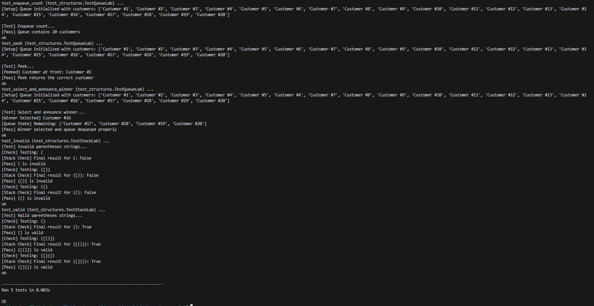

# Lab: Stacks and Queues

## Overview

This project demonstrates the implementation of two fundamental data structures in Python: **stacks** and **queues**.

The lab focuses on applying Last In, First Out (LIFO) and First In, First Out (FIFO) principles to solve two practical problems:

1. **Stack-Based Parentheses Validation** — Determine whether a string contains correctly balanced and nested brackets.
2. **Queue-Based Customer Raffle** — Manage customer entries, randomly select a winner, and process customers in FIFO order.

The project includes automated tests to verify the functionality of both implementations.

## Technologies Used

- Python 3
- Python Standard Library
- `random` module
- `unittest` framework
- Git and GitHub

## Project Structure

```text
stacks-and-queues-lab/
├── custom_stack.py
├── custom_queue.py
├── test_structures.py
├── screenshots/
│   └── test_suite.png
└── README.md
```

### File Descriptions

| File | Description |
|------|-------------|
| `custom_stack.py` | Implements stack-based bracket validation. |
| `custom_queue.py` | Implements a FIFO queue and raffle winner selection. |
| `test_structures.py` | Contains automated tests for both data structures. |
| `screenshots/` | Contains screenshots demonstrating test results. |
| `README.md` | Provides project documentation and usage instructions. |

---

## Part 1: Stack Implementation

### Understanding Stacks

A stack follows the **Last In, First Out (LIFO)** principle.

The most recently added item is the first item removed.

Common stack operations include:

- **Push:** Add an item to the top of the stack.
- **Pop:** Remove and return the most recently added item.
- **Peek:** Examine the top item without removing it.

### Parentheses Validator

**File:** `custom_stack.py`

**Function:** `is_valid_parentheses(s: str) -> bool`

The validator determines whether a string contains properly balanced and nested brackets.

Supported bracket types:

```python
()
{}
[]
```

### Implementation Details

The validator uses a Python list as a stack.

1. Initialize an empty stack.
2. Iterate through each character in the input string.
3. Push opening brackets onto the stack.
4. When encountering a closing bracket, verify that the stack is not empty.
5. Remove the most recent opening bracket using `.pop()`.
6. Compare the removed bracket against the expected matching bracket.
7. Return `False` if brackets do not match or an unsupported character is encountered.
8. After processing all characters, return `True` only if the stack is empty.

A dictionary maps closing brackets to their corresponding opening brackets:

```python
bracket_pairs = {
    ")": "(",
    "}": "{",
    "]": "["
}
```

### Example Usage

```python
from custom_stack import is_valid_parentheses

print(is_valid_parentheses("()"))       # True
print(is_valid_parentheses("{[()]}"))   # True
print(is_valid_parentheses("([]{})"))   # True

print(is_valid_parentheses("([)]"))     # False
print(is_valid_parentheses("((("))      # False
print(is_valid_parentheses("(hello)"))  # False
```

### Edge Case Handling

The validator also handles several invalid input scenarios.

| Input | Result | Explanation |
|-------|--------|-------------|
| `()` | `True` | Correctly matched parentheses. |
| `{[()]}` | `True` | Correctly nested brackets. |
| `([)]` | `False` | Incorrect bracket nesting. |
| `(((` | `False` | Unmatched opening brackets. |
| `())` | `False` | Unmatched closing bracket. |
| `(hello)` | `False` | Contains unsupported characters. |
| `""` | `False` | Empty strings are explicitly rejected. |

**Note:** Although some balanced-parentheses implementations consider an empty string valid, this implementation explicitly rejects empty input.

### Time and Space Complexity

**Time Complexity: O(n)**

Each character is processed once, and stack operations such as `append()` and `pop()` from the end of a list take amortized constant time.

**Space Complexity: O(n)**

In the worst case, every character is an opening bracket, requiring storage of all characters in the stack.

---

## Part 2: Queue Implementation

### Understanding Queues

A queue follows the **First In, First Out (FIFO)** principle.

The first item added to the queue is the first item removed.

This behavior is commonly used in:

- Customer service systems
- Task scheduling
- Print queues
- Request processing
- Event management

### Queue Class

**File:** `custom_queue.py`

**Class:** `Queue`

The queue uses a Python list to store customer entries.

### Queue Methods

| Method | Description |
|--------|-------------|
| `__init__()` | Initializes an empty queue. |
| `enqueue(item)` | Adds an item to the end of the queue. |
| `dequeue()` | Removes and returns the first item. |
| `peek()` | Returns the first item without removing it. |
| `is_empty()` | Returns whether the queue is empty. |
| `select_and_announce_winner()` | Randomly selects a winner and dequeues customers up to and including the winner. |

### Enqueue

Adds an item to the end of the queue.

```python
def enqueue(self, item):
    self.items.append(item)
```

### Dequeue

Removes and returns the first item in the queue.

```python
def dequeue(self):
    if not self.items:
        return None
    return self.items.pop(0)
```

If the queue is empty, the method returns `None` rather than raising an exception.

### Peek

Returns the first item without removing it.

```python
def peek(self):
    if not self.items:
        return None
    return self.items[0]
```

### Is Empty

Checks whether the queue contains any items.

```python
def is_empty(self):
    if not self.items:
        return True
    return False
```

### Example Usage

```python
from custom_queue import Queue

queue = Queue()

queue.enqueue("Customer #1")
queue.enqueue("Customer #2")
queue.enqueue("Customer #3")

print(queue.peek())       # Customer #1
print(queue.dequeue())    # Customer #1
print(queue.is_empty())   # False
print(queue.items)        # ['Customer #2', 'Customer #3']
```

---

## Part 3: Customer Raffle Simulation

### Overview

The customer raffle demonstrates how a queue can be used to process entries in FIFO order while randomly selecting a winner.

The method `select_and_announce_winner()` uses Python's `random` module to select a customer from the queue.

### Implementation Process

1. Verify that the queue is not empty.
2. Randomly select a customer using `random.choice()`.
3. Store the selected customer in `random_winner`.
4. Use a `while` loop to dequeue customers until the winner reaches the front.
5. Dequeue the winner.
6. Return the selected customer's name.

### Example Scenario

Consider the following queue:

```python
[
    "John",
    "Bob",
    "Alice",
    "Sarah"
]
```

Suppose `"Alice"` is randomly selected.

The queue processes customers in this order:

```text
1. John is dequeued.
2. Bob is dequeued.
3. Alice is dequeued.
4. Sarah remains in the queue.
```

The method returns:

```python
"Alice"
```

The remaining queue contains:

```python
["Sarah"]
```

### Example Usage

```python
from custom_queue import Queue

queue = Queue()

queue.enqueue("John")
queue.enqueue("Bob")
queue.enqueue("Alice")
queue.enqueue("Sarah")

winner = queue.select_and_announce_winner()

print(f"Winner: {winner}")
print(f"Remaining queue: {queue.items}")
```

**Note:** The winner is randomly selected, so the output will vary between executions.

### Edge Case Handling

- If the queue is empty, winner selection returns `None`.
- Customers are dequeued in FIFO order.
- The selected winner is also removed from the queue.
- Customers behind the winner remain in the queue.

The raffle assumes customer entries are uniquely identifiable. If duplicate customer names are present, the current implementation may stop at the first matching name.

---

## Part 4: Time Complexity Analysis

The following table summarizes the time complexity of the implemented operations.

| Operation | Time Complexity | Explanation |
|-----------|-----------------|-------------|
| Stack push | O(1) amortized | Appends an item to the end of a list. |
| Stack pop | O(1) | Removes the last item from a list. |
| Parentheses validation | O(n) | Processes each character once. |
| Queue enqueue | O(1) amortized | Appends an item to the end of the queue. |
| Queue dequeue | O(n) | Removes the first item and shifts remaining elements. |
| Queue peek | O(1) | Accesses the first element directly. |
| Queue is_empty | O(1) | Checks whether the list is empty. |
| Raffle winner selection | O(n²) worst case | Repeatedly dequeues from the front of a Python list. |

### Performance Considerations

The queue implementation uses a Python list to demonstrate FIFO behavior.

Removing an item using `pop(0)` requires shifting the remaining elements, resulting in O(n) time complexity.

For larger applications, Python's `collections.deque` would provide more efficient removal from the front of a queue.

However, the list-based implementation is appropriate for demonstrating the core concepts required by this assignment.

---

## Part 5: Installation and Setup

### Prerequisites

- Python 3 installed
- Git installed
- A terminal or Python-compatible IDE

### Clone the Repository

Clone your forked repository:

```bash
git clone https://github.com/Matt20Swanberg/stacks-and-queues-lab
```

Navigate into the project directory:

```bash
cd stacks-and-queues-lab
```

### Dependencies

The project uses Python's standard library.

No additional third-party packages are required for the stack and queue implementations or the provided tests.

---

## Part 6: Testing

### Automated Test Suite

The project includes automated tests in `test_structures.py`.

Run the complete test suite:

```bash
python test_structures.py
```

Alternatively, run the tests using Python's `unittest` module:

```bash
python -m unittest -v test_structures
```

### Test Coverage

The provided test suite verifies five scenarios:

| Test | Result |
|------|--------|
| Enqueue count | Passed |
| Peek functionality | Passed |
| Random winner selection | Passed |
| Invalid parentheses validation | Passed |
| Valid parentheses validation | Passed |

### Test Results

All five automated tests passed successfully.

```text
----------------------------------------------------------------------
Ran 5 tests in 0.00Xs

OK
```

### Screenshot

#### Test Suite — All Tests Passing



---

## Key Takeaways

This lab reinforced several important Python and data structure concepts:

- Understanding the differences between LIFO and FIFO.
- Using Python lists to implement stacks and queues.
- Applying `.append()` and `.pop()` to manage stored elements.
- Using dictionaries to validate matching bracket pairs.
- Implementing conditional logic to handle invalid inputs.
- Using `while` loops to process queue entries.
- Using the `random` module to select a raffle winner.
- Handling edge cases such as empty data structures.
- Understanding the time complexity of common data structure operations.
- Verifying functionality through automated tests.

## Conclusion

This project demonstrates practical implementations of stacks and queues in Python.

The stack-based validator verifies correctly balanced brackets, while the queue-based raffle simulation demonstrates FIFO processing and random winner selection.

Both implementations successfully passed the provided automated test suite, confirming the required functionality.

## Author

Created by Matthew Swanberg as part of Course 10 Module 5 (Lab: Stacks and Queues)